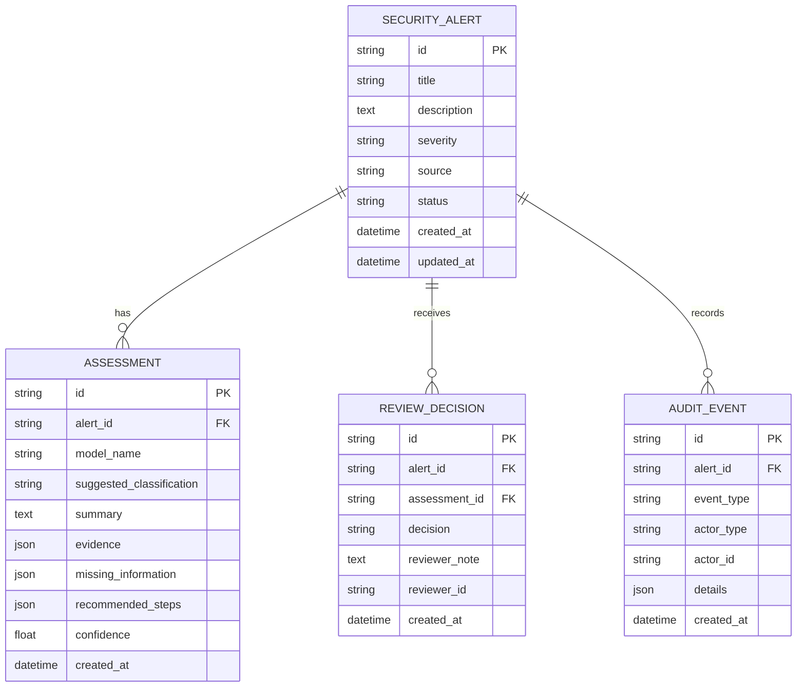

# ThreatIQ — Database Schema

## 1. Overview

**Project:** ThreatIQ — AI-Powered Cybersecurity Investigation Assistant

**Purpose:** Define the database entities, relationships, constraints, and data flow required to investigate security alerts, store AI-generated assessments, record human decisions, and maintain an audit history.

### Database technology

| Component | Choice |
|---|---|
| MVP database | SQLite |
| Future production option | PostgreSQL |
| ORM | SQLModel / SQLAlchemy |
| Schema validation | Pydantic |
| Schema migrations | Alembic |
| Primary key format | UUID strings |
| Timestamps | UTC |
| Data source | Synthetic security data for the MVP |

The database must preserve the distinction between an AI recommendation and a human analyst's final decision.

---

## 2. Entity Overview

ThreatIQ uses four primary database entities.

| Entity | Purpose |
|---|---|
| `SecurityAlert` | Stores the original security alert and its investigation status |
| `Assessment` | Stores AI-generated analysis, classification, evidence, and recommendations |
| `ReviewDecision` | Stores the human analyst's decision and optional notes |
| `AuditEvent` | Records important investigation and review activities |

### Entity responsibilities

**SecurityAlert**

Represents a security event that requires investigation. It contains the alert's title, description, severity, source, timestamps, and current workflow status.

**Assessment**

Represents one AI analysis of an alert. An alert may have multiple assessments as the analyst reruns the analysis or obtains new evidence.

**ReviewDecision**

Represents a human review of an alert. Multiple decisions can be retained to preserve the review history.

**AuditEvent**

Represents an important action in the system, such as creating an alert, generating an assessment, or recording an analyst's decision.

---

## 3. Entity Relationship Diagram



### Relationship summary

- One `SecurityAlert` can have many `Assessment` records.
- One `SecurityAlert` can have many `ReviewDecision` records.
- One `SecurityAlert` can have many `AuditEvent` records.
- One `Assessment` can be referenced by multiple review decisions over time.
- Every assessment, decision, and audit event belongs to an alert.
- Deleting an alert should not silently erase the investigation's audit trail. Prefer archival or controlled retention policies.

---

## 4. Database Tables

### 4.1 `security_alerts`

Stores the original alert received by ThreatIQ.

| Column | Type | Constraints | Description |
|---|---|---|---|
| `id` | String / UUID | Primary key | Unique alert identifier |
| `title` | String | Required | Short alert title |
| `description` | Text | Required | Original alert description |
| `severity` | String | Required | `low`, `medium`, `high`, `critical` |
| `source` | String | Required | Origin of the alert or simulated system |
| `status` | String | Required | Current investigation workflow status |
| `created_at` | DateTime | Required | Original alert creation time |
| `updated_at` | DateTime | Required | Last alert record update |

Suggested status values:

- `new`
- `investigating`
- `awaiting_review`
- `resolved`

The status describes the workflow, not whether the alert is a true or false positive. The human decision is stored separately.

### 4.2 `assessments`

Stores the output of each AI investigation.

| Column | Type | Constraints | Description |
|---|---|---|---|
| `id` | String / UUID | Primary key | Unique assessment identifier |
| `alert_id` | String / UUID | Foreign key → `security_alerts.id` | Alert being analyzed |
| `model_name` | String | Required | Model used for the assessment |
| `suggested_classification` | String | Required | AI's suggested classification |
| `summary` | Text | Required | Plain-language assessment summary |
| `evidence` | JSON | Required | Evidence items supporting the assessment |
| `missing_information` | JSON | Required | Information needed for a stronger conclusion |
| `recommended_steps` | JSON | Required | Suggested investigation steps |
| `confidence` | Float | Nullable | Optional model-derived confidence, if meaningfully defined |
| `created_at` | DateTime | Required | Assessment creation time |

Allowed classification values:

- `likely_true_positive`
- `likely_false_positive`
- `needs_review`

**Important:** `suggested_classification` is an AI recommendation, not a confirmed outcome. Do not treat a model's confidence as a calibrated probability unless calibration has been validated.

Example `evidence` value:

```json
[
  {
    "source_type": "alert",
    "source_id": "alert-001",
    "description": "Multiple failed login attempts followed by a successful login.",
    "observed_at": "2026-10-28T09:30:00Z"
  },
  {
    "source_type": "historical_incident",
    "source_id": "incident-014",
    "description": "A similar sequence was previously reviewed as suspicious."
  }
]
```

The example illustrates the structure only; it is not a claim about actual ThreatIQ data.

### 4.3 `review_decisions`

Stores human decisions separately from AI assessments.

| Column | Type | Constraints | Description |
|---|---|---|---|
| `id` | String / UUID | Primary key | Unique decision identifier |
| `alert_id` | String / UUID | Foreign key → `security_alerts.id` | Reviewed alert |
| `assessment_id` | String / UUID | Nullable foreign key → `assessments.id` | Assessment being reviewed |
| `decision` | String | Required | Human-selected outcome |
| `reviewer_note` | Text | Nullable | Optional explanation |
| `reviewer_id` | String | Nullable for demo | Reviewer identifier |
| `created_at` | DateTime | Required | Decision timestamp |

Allowed decision values:

- `true_positive`
- `false_positive`
- `needs_further_review`

A decision may reference the assessment that was shown to the analyst. If an analyst reviews an alert without an AI assessment, `assessment_id` may be null.

Do not overwrite previous decisions. Insert a new record when a subsequent review changes the outcome.

### 4.4 `audit_events`

Stores important actions for investigation traceability.

| Column | Type | Constraints | Description |
|---|---|---|---|
| `id` | String / UUID | Primary key | Unique event identifier |
| `alert_id` | String / UUID | Foreign key → `security_alerts.id` | Related alert |
| `event_type` | String | Required | Type of recorded event |
| `actor_type` | String | Required | `system`, `ai`, or `human` |
| `actor_id` | String | Nullable | User or component identifier |
| `details` | JSON | Required | Relevant event metadata |
| `created_at` | DateTime | Required | Event timestamp |

Suggested event types:

- `alert_created`
- `assessment_started`
- `assessment_completed`
- `assessment_failed`
- `decision_recorded`
- `status_changed`

Audit events should be append-only through normal application operations. Restrict updates and deletions, and avoid placing API keys, passwords, or unnecessary sensitive data in event details.

---

## 5. Relationships in Detail

### SecurityAlert → Assessment

**Relationship:** One-to-many.

An alert can be analyzed repeatedly. Each successful assessment creates a new row with its own identifier and timestamp.

Example:

```text
Alert A
 ├── Assessment 1 — needs_review
 ├── Assessment 2 — likely_true_positive
 └── Assessment 3 — likely_true_positive
```

All assessments remain available for comparison and investigation history.

### SecurityAlert → ReviewDecision

**Relationship:** One-to-many.

An analyst can make a decision and later revisit the alert. Each review is stored independently.

```text
Alert A
 ├── Decision 1 — needs_further_review
 └── Decision 2 — true_positive
```

The application can display the most recent decision while preserving the earlier record.

### Assessment → ReviewDecision

**Relationship:** One-to-many, optional.

A decision may reference the assessment the analyst reviewed. This helps answer which AI output was available when the decision was made.

The application must validate that the selected assessment belongs to the same alert as the decision.

### SecurityAlert → AuditEvent

**Relationship:** One-to-many.

Each important action creates an audit record associated with the alert. The history view can combine assessments, decisions, and audit events into a chronological timeline.

---

## 6. Constraints and Indexes

### Required constraints

1. Every alert must have a unique ID.
2. Every assessment must reference an existing alert.
3. Every non-null assessment reference in a decision must reference an existing assessment.
4. A decision's assessment must belong to the same alert referenced by that decision.
5. Severity, workflow status, AI classification, and human decision must use approved values.
6. Timestamps must use a consistent UTC convention.
7. Historical assessments and decisions must not be overwritten when new records are created.

### Recommended indexes

| Table | Index | Purpose |
|---|---|---|
| `security_alerts` | `severity` | Filter by severity |
| `security_alerts` | `status` | Filter by workflow status |
| `security_alerts` | `created_at` | Sort alerts by creation time |
| `assessments` | `(alert_id, created_at)` | Retrieve assessment history |
| `review_decisions` | `(alert_id, created_at)` | Retrieve decision history |
| `audit_events` | `(alert_id, created_at)` | Retrieve audit timeline |

Enable SQLite foreign-key enforcement in the database connection configuration.

---

## 7. Example Data Flow

When an analyst investigates an alert:

1. ThreatIQ retrieves the `SecurityAlert` record.
2. The application gathers relevant evidence and historical context.
3. The AI service generates an assessment.
4. ThreatIQ stores the output in `assessments`.
5. An audit event records the assessment result.
6. The analyst reviews the evidence and selects a decision.
7. ThreatIQ inserts a `review_decisions` record.
8. The alert's workflow status is updated if appropriate.
9. Another audit event records the decision and status change.

The assessment and decision should be saved transactionally where appropriate so the UI does not display a confirmed human decision that failed to persist.

---

## 8. Example SQL Queries

### Retrieve alerts by severity

```sql
SELECT id, title, severity, status, created_at
FROM security_alerts
WHERE severity IN ('high', 'critical')
ORDER BY created_at DESC;
```

### Retrieve all assessments for an alert

```sql
SELECT id, model_name, suggested_classification, summary, created_at
FROM assessments
WHERE alert_id = :alert_id
ORDER BY created_at DESC;
```

### Retrieve decision history

```sql
SELECT id, decision, reviewer_note, reviewer_id, created_at
FROM review_decisions
WHERE alert_id = :alert_id
ORDER BY created_at DESC;
```

### Retrieve audit history

```sql
SELECT event_type, actor_type, actor_id, details, created_at
FROM audit_events
WHERE alert_id = :alert_id
ORDER BY created_at ASC;
```

---

## 9. Implementation Notes

- Use SQLModel models to define tables and relationships.
- Use Pydantic schemas to validate incoming API requests and outgoing responses.
- Use Alembic migrations for schema changes.
- Store API credentials in environment variables, never in database seed files or frontend code.
- Seed the MVP with clearly labeled synthetic alerts and historical incidents.
- Keep original alert data separate from AI-generated assessments.
- Keep AI recommendations separate from analyst decisions.
- Record model failures rather than fabricating an assessment.
- Store evidence references and source descriptions so analysts can inspect the basis for an AI recommendation.
- If historical incident retrieval uses ChromaDB, treat it as a separate retrieval index. Store only the identifiers and useful metadata needed to connect retrieved results to application records.
- If public threat-intelligence search is enabled, retain source URLs and retrieval timestamps with the relevant evidence. Avoid treating retrieved web content as trusted instructions.

---

## 10. MVP Scope vs Future Improvements

### Required for the MVP

- `security_alerts`
- `assessments`
- `review_decisions`
- `audit_events`
- Foreign-key relationships
- Decision and classification validation
- Assessment history
- Human review history
- Synthetic seed data

### Future improvements

- Dedicated users and roles tables.
- Organizations and tenant isolation.
- External threat-intelligence source records.
- Evidence stored as normalized rows instead of JSON.
- Model and prompt version tracking.
- Explicit links to retrieved historical incidents.
- Audit-event integrity verification.
- Retention policies and controlled archival.
- PostgreSQL migration and deployment hardening.

Do not add these extra tables until a real feature requires them.

---

## 11. Final Design Rule

The database must preserve three separate concepts:

1. **What happened:** the original security alert.
2. **What the AI suggested:** the assessment and its supporting evidence.
3. **What the analyst decided:** the human review outcome.

These records must remain linked, traceable, and independently identifiable. This separation is central to ThreatIQ's investigation workflow and auditability.
